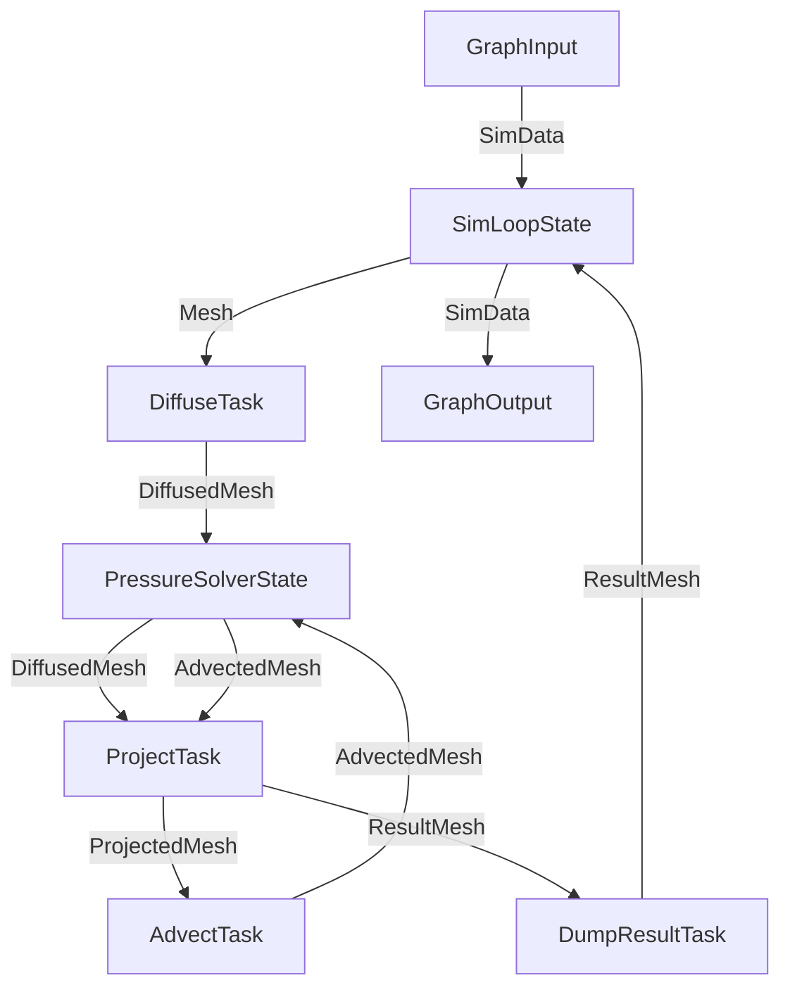

# Graph

A *graph* is used to create edges between nodes and run the tasks. A graph is
also a node which allows creating sub-graphs.

## Basic graph

```cpp
auto graph = hh::make_graph<1, int, int>("My Graph"); // the graph name is optional
auto task  = hh::make_task<MyTask>(4, "My Task");     // create a 4 thread task

graph->connect_inputs(task);  // set task as graph input
graph->connect_outputs(task); // set task as graph output

graph->start();                           // start the graph (initialize nodes and spawn threads)
graph->push_data(hh::make_data<int>(42)); // push some data to process
auto result = graph->get_result();        // block until results arrive
graph->stop();                            // stop the graph (join threads)

// result is a std::variant<data_t<T>...> with one alternative per output type
int data = std::get<hh::data_t<int>>(result);
```

Break down graph creation:

- The `make_graph<NbInputs, Types...>` function creates a graph. The input and
  output types are specified in a single list which is split based on
  `NbInputs`.
- For the task, see [task](task.md).
- `connect_inputs` connects all the inputs of the task that intersect the inputs
  of the graph to the graph input (`connect_outputs` does the same thing for
  outputs). A graph can have multiple input nodes.

Examples:

```cpp
struct Task {
    using inputs  = hh::type_list<int, float>;
    using outputs = hh::type_list<int, float>;
    //...
};

auto graph = hh::make_graph<?>(); // ? values are listed in the table bellow
auto task = hh::make_task<Task>();

graph->connect_inputs(task);
graph->connect_outputs(task);
```

| make_graph             | graph inputs   | graph output   | connected inputs | connected outputs |
|------------------------|----------------|----------------|------------------|-------------------|
| `<1, int, int>`        | `int`          | `int`          | `int`            | `int`             |
| `<2, int, float, int>` | `int`, `float` | `int`          | `int`, `float`   | `int`             |
| `<1, int, float, int>` | `int`          | `int`, `float` | `int`            | `int`, `float`    |

Break down graph execution:

- `graph->start()` initializes the nodes and run them (spawn threads).
- `graph->push_data(...)` pushes data to the graph input nodes (can be called
  multiple times with different data types).
- `graph->get_result()` blocks until results arrive (can be called multiple
  times if there are multiple results).
- `graph->get_result()` returns a `std::variant<data_t<T>...>` with one
  alternative per output type. Use `std::get<hh::data_t<T>>(result)` to
  extract the value for a specific type.
- `graph->eat_results(count)` calls `get_result()` `count` times and
  discards the results. Use it to drain the graph when you don't need the
  output values (defaults to `count = 1`).
- `graph->stop()` finalises the nodes and joins the threads. It kills the
  graph immediately **without waiting for all the data to be processed**. You
  have to use either `get_result` or `eat_results` to block before shutting
  down the threads (this makes the termination logic fast).

## Edges

Here are the functions used to draw edges between nodes and graphs:

- `graph->connect_inputs(node)`: connects the input edges of a node to the
  inputs of the graph for the common types.
- `graph->connect_input<T>(node)`: connects the input edge for the type `T` of
  the node to the input of the type `T` of the graph.
- `graph->connect_outputs(node)`: same as `connect_inputs` for the output.
- `graph->connect_output<T>(node)`: same as `connect_input<T>` for the output.
- `graph->draw_edges(sender_node, receiver_node)`: draw edges between two nodes
  for the common types.
- `graph->draw_edge<T>(sender_node, receiver_node)`: draw an edge for the type
  `T` between two nodes.

Example:

Here is a slightly more complex graph with many nodes and edges. We use data
types to control the routing (one task my output a different type depending on
the stage of the computation). We also have cycles to models loops and reuse
nodes.



```cpp
graph->connect_inputs(sim_loop_state);
graph->draw_edges(sim_loop_state, diffuse_task);
graph->draw_edges(diffuse_task, pressure_solver_state);
graph->draw_edges(pressure_solver_state, project_task);
graph->draw_edges(project_task, advect_task);
graph->draw_edges(advect_task, pressure_solver_state);
graph->draw_edges(project_task, dump_result_task);
graph->draw_edges(dump_result_task, sim_loop_state);
graph->connect_outputs(sim_loop_state);
```

### Custom edges

One may also need to create custom edges for various purposes (filtering,
implement network transfer, ...). An edge is just a transfer function that
describes how the data moves between nodes. This transfer function may have
different signatures and should return `true` when the data is transferred
(`false` for filtered/failed transfer):

- `transfer(auto graph, auto receiver, data_t<T> data, &RuntimeInfo const &info)`.
- `transfer(auto receiver, data_t<T> data, &RuntimeInfo const &info)`.
- `transfer(data_t<T> data, &RuntimeInfo const &info)`.

Examples:

```cpp
// filter out zeros
graph->connect_input<int>(node, [](auto receiver, hh::data_t<int> data, hh::RuntimeInfo const &info) {
    if (*data == 0) {
        return false;
    }
    receiver->push_data(std::move(data), info); // we transfer the data to the node
    return true;
});

// we can also create custom edges for common types
graph->draw_edges(sender, receiver, []<typename T>(auto args) {
    return hh::make_edge<T>(args, [](auto receiver, auto data, hh::RuntimeInfo const &info) {
        // filter ints
        if constexpr (std::is_same_v<T, int>) {
            return false;
        } else {
            receiver->push_data(std::move(data), info);
            return true;
        }
    });
});
```

#### Raw edge

It is also possible to create an `Edge<T>` directly, but this requires manual
type casting.

```cpp
Edge<T> edge(receiver, graph, [](Edge<T> *e, data_t<T> data, RuntimeInfo const &info) {
    auto receiver = static_cast<ReceiverType *>(e->receiver);
    auto graph    = static_cast<GraphType *>(e->graph);

    // transfer the data
    receiver->push_data(std::move(data), info);

    // call runner->on_transfer (this will be explained in the runner section)
    graph->runner()->on_transfer(receiver, info);
});
```

### Edge builder

The edge builder is part of the graph configuration and allows customizing how
default edges are created (when no custom edge is specified). The default
builder is called `DirectEdgeBuilder` and creates a direct connection between
two nodes:

```cpp
struct DirectEdgeBuilder {
    template <typename T>
    static Edge<T> make_edge(auto graph, auto sender, auto receiver) {
        using Receiver = std::remove_pointer_t<decltype(receiver)>;
        using Graph    = std::remove_pointer_t<decltype(graph)>;

        // we create a raw edge
        return Edge<T>(graph, receiver, [](Edge<T> *e, data_t<T> data, RuntimeInfo const &info) {
            auto receiver = static_cast<Receiver *>(e->receiver);
            auto graph    = static_cast<Graph *>(e->graph);
            receiver->push_data(std::move(data), info);
            graph->runner()->on_transfer(receiver, info);
        });
    }
};
```

## Runner

The graph runner is responsible for executing the graph and implement the
following functions:

```cpp
struct Runner {
    void register_node(auto *node);                    // called when nodes are registered in the graph
    void initialize(InitializationInfo const &);       // called when the graph is initialized (start)
    void finalize(InitializationInfo const &);         // called when the graph is finalized (stop)
    void run(RunInfo const &info);                     // called after the initialization (ThreadRunner spawns threads here)
    void on_transfer(auto *node, RuntimeInfo const &); // called on successful transfer within an edge
    void on_result();                                  // called in graph->get_result/graph->eat_results
};
```

Hedgehog includes the following runners:
- `SerialRunner`: do not spawn any thread, runs the graph serially.
- `ThreadRunner`: bind threads to nodes (spawns node->number_threads for each node).
- `TBBRunner`: runs the whole graph using a One-TBB task arena.

## Serial graph

`make_serial_graph` creates a graph that runs entirely single-threaded using
the `SerialRunner`. No threads are spawned; the graph processes data
synchronously. This is useful for debugging and testing.

```cpp
auto graph = hh::make_serial_graph<1, int, int>("My Serial Graph");
```

The template arguments are the same as `make_graph`.

## Custom runner graph

`make_graph` can also take an explicit runner instance:

```cpp
auto runner = std::make_shared<hh::TBBRunner>();
auto graph  = hh::make_graph<hh::TBBRunner, 1, int, int>(runner, "TBB Graph");
```

## Graph start options

`start` accepts an optional `rank` parameter (defaults to 0). The rank is
passed to the runner via `RunInfo` and can be used to identify the graph
instance (e.g. when using execution pipelines):

```cpp
graph->start();    // rank = 0
graph->start(2);   // rank = 2
```

A graph can be started, stopped, and restarted. The internal topology is only
built once (`build_once()` guard), so restarting a graph does not rebuild
edges.

## Sub-graphs

A graph is also a node. You can wire a graph as a node inside another graph to
create hierarchical compositions:

```cpp
auto outer = hh::make_graph<1, int, int>("Outer");
auto inner = hh::make_graph<1, int, int>("Inner");
auto task   = hh::make_task<MyTask>(2);

// build the inner graph
inner->connect_inputs(task);
inner->connect_outputs(task);

// wire inner graph as a node in the outer graph
outer->connect_inputs(inner);
outer->connect_outputs(inner);

outer->start();
outer->push_data(hh::make_data<int>(42));
auto result = outer->get_result();
outer->stop();
```

Input edges are flattened: when connecting a sub-graph, the parent graph
creates direct edges to the sub-graph's input nodes (no intermediate
buffering). Output edges are deferred and connected when the parent graph is
built.

## Graph view and analysis

`build_graph_view()` builds a `GraphView` — a type-erased representation of
the graph topology. It can be used for visualization and analysis.

```cpp
auto view = graph->build_graph_view();
```

### Dot file generation

`generate_dot_file` produces a Graphviz dot file. When `HH_ENABLE_PROFILING`
is defined, the dot file includes profiling data; otherwise it shows topology
only.

```cpp
graph->generate_dot_file("graph.dot");
```

See [profiling](profiling.md) for more details on profiling setup.

### Cycle detection

`ga_cycle_detection` (from `hedgehog/tool/graph_analysis.hpp`) detects and
prints cycles in the graph topology:

```cpp
auto view = graph->build_graph_view();
size_t num_cycles = hh::ga_cycle_detection(view);
```

## Graph configuration

Most node types like `TaskNode`, the graph only has one template parameter
which is a configuration type. Here is how to build a custom configuration:

```cpp
struct Config {
    // input outputs are usually deduced from the list given to `make_graph`
    using InputTypes  = hh::type_list<int, float>;
    using OutputTypes = hh::type_list<int, float>;
    // the configuration also allows to customize some of the graph components
    using Sink        = hh::GraphSink<int, float>;
    using Runner      = hh::ThreadRunner;
    using EdgeBuilder = DirectEdgeBuilder;
};
auto graph = std::make_shared<Graph<Config>>(runner, NodeInfo{name, 0});
```
