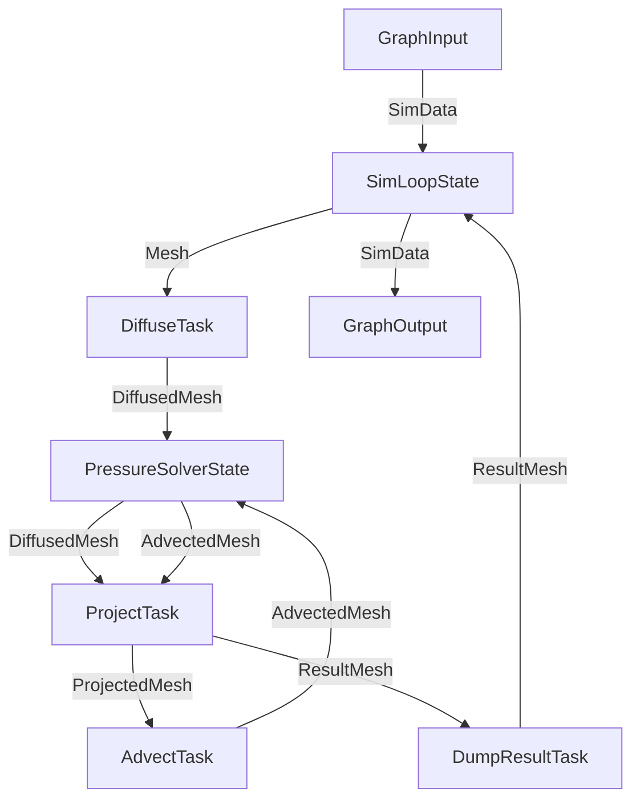

# Graph

A graph is used to create edges between nodes and run the tasks. A graph is
also a node which allows creating sub-graphs.

## Basic graph

```cpp
auto graph = hh::make_graph<1, int, int>("My Graph"); // the graph name is optional
auto task  = hh::make_task<MyTask>(4, "My Task");     // create a 4 thread task

graph->connect_inputs(task);  // set task as graph input
graph->connect_outputs(task); // set task as graph output

graph->start();                           // start the graph (initialize nodes and spawn threads)
graph->push_data(hh::make_data<int>(42)); // push some data to process
auto result = graph->get_result();        // block until resutls arrive
graph->stop();                            // stop the graph (join threads)

int data = std::get<hh::data_t<int>>(result); // result is a variant
```

Break down graph creation:

- The `make_graph<NbInputs, Types...>` function creates a graph. The input and
  output types are specified in a single list which is split based on
  `NbInputs`.
- For the task, see [task](task.md).
- `connect_inputs` connects all the inputs of the task that intersect the inputs
  of the graph to the graph input (`connect_outputs` does the same thing for
  outputs). A graph can have multiple input nodes.

Examples:

```cpp
struct Task {
    using inputs  = hh::type_list<int, float>;
    using outputs = hh::type_list<int, float>;
    //...
};

auto graph = hh::make_graph<?>(); // ? values are listed in the table bellow
auto task = hh::make_task<Task>();

graph->connect_inputs(task);
graph->connect_outputs(task);
```

| make_graph             | graph inputs   | graph output   | connected inputs | connected outputs |
|------------------------|----------------|----------------|------------------|-------------------|
| `<1, int, int>`        | `int`          | `int`          | `int`            | `int`             |
| `<2, int, float, int>` | `int`, `float` | `int`          | `int`, `float`   | `int`             |
| `<1, int, float, int>` | `int`          | `int`, `float` | `int`            | `int`, `float`    |

Break down graph execution:

- `graph->start()` initializes the nodes and run them (spawn threads).
- `graph->push_data(...)` pushes data to the graph input nodes (can be called
  multiple times with different data types).
- `graph->get_result()` blocks until results arrive (can be called multiple
  times if there are multiple results).
- `graph->stop()` finalises the nodes and joins the threads. It kills the
  graph immediately **without waiting for all the data to be processed**. You
  have to use either `get_result` or `eat_results` to block before shutting
  down the threads (this makes the termination logic fast).

## Edges

Here are the functions used to draw edges between nodes and graphs:

- `graph->connect_inputs(node)`: connects the input edges of a node to the
  inputs of the graph for the common types.
- `graph->connect_input<T>(node)`: connects the input edge for the type `T` of
  the node to the input of the type `T` of the graph.
- `graph->connect_outputs(node)`: same as `connect_inputs` for the output.
- `graph->connect_output<T>(node)`: same as `connect_input<T>` for the output.
- `graph->draw_edges(sender_node, receiver_node)`: draw edges between two nodes
  for the common types.
- `graph->draw_edge<T>(sender_node, receiver_node)`: draw an edge for the type
  `T` between two nodes.

Example:

Here is a slightly more complex graph with many nodes and edges. We use data
types to control the routing (one task my output a different type depending on
the stage of the computation). We also have cycles to models loops and reuse
nodes.



```cpp
graph->connect_inputs(sim_loop_state);
graph->draw_edges(sim_loop_state, diffuse_task);
graph->draw_edges(diffuse_task, pressure_solver_state);
graph->draw_edges(pressure_solver_state, project_task);
graph->draw_edges(project_task, advect_task);
graph->draw_edges(advect_task, pressure_solver_state);
graph->draw_edges(project_task, dump_result_task);
graph->draw_edges(dump_result_task, sim_loop_state);
graph->connect_outputs(sim_loop_state);
```

### Custom edges

One may also need to create custom edges for various purposes (filtering,
implement network transfer, ...). An edge is just a transfer function that
describes how the data moves between nodes. This transfer function may have
different signatures and should return `true` when the data is transferred
(`false` for filtered/failed transfer):

- `transfer(auto graph, auto receiver, data_t<T> data, &RuntimeInfo const &info)`.
- `transfer(auto receiver, data_t<T> data, &RuntimeInfo const &info)`.
- `transfer(data_t<T> data, &RuntimeInfo const &info)`.

Examples:

```cpp
// filter out zeros
graph->connect_input<int>(node, [](auto receiver, hh::data_t<int> data, hh::RuntimeInfo const &info) {
    if (*data == 0) {
        return false;
    }
    receiver->push_data(std::move(data), info); // we transfer the data to the node
    return true;
});

// we can also create custom edges for common types
graph->draw_edges(sender, receiver, []<typename T>(auto args) {
    return hh::make_edge<T>(args, [](auto receiver, auto data, hh::RuntimeInfo const &info) {
        // filter ints
        if constexpr (std::is_same_v<T, int>) {
            return false;
        } else {
            node2->push_data(std::move(data), info);
            return true;
        }
    });
});
```

#### Raw edge

It is also possible to create an `Edge<T>` directly, but this requires manual
type casting.

```cpp
Edge<T> edge(receiver, graph, [](Edge<T> *e, data_t<T> data, RuntimeInfo const &info) {
    auto receiver = static_cast<ReceiverType *>(e->receiver);
    auto graph    = static_cast<GraphType *>(e->graph);

    // transfer the data
    receiver->push_data(std::move(data), info);

    // call runner->on_transfer (this will be explained in the runner section)
    graph->runner()->on_transfer(receiver, info);
});
```
