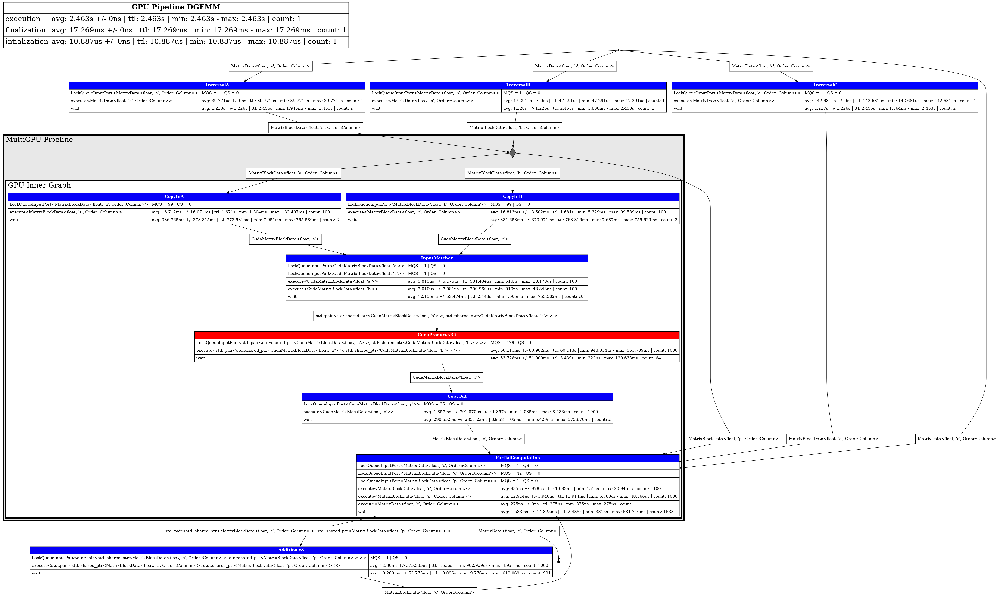

# Profiling

Hedgehog node all have one or more profilers. The `TaskNode` has a main
profiler used internally as well as thread local profilers that are accessible
through the execution context.

```cpp
struct Task {
    using inputs  = hh::type_list<int>;
    using outptus = hh::type_list<int>;

    hh::Profile *region = nullptr;
    hh::Profile *marker = nullptr;

    void initialize(auto ctx) {
        // initialize the profile entries
        region = ctx->profiler()->profile_region("Region Name");
        marker = ctx->profiler()->profile_marker("Marker Name");
    }

    void execute(auto ctx , auto data) {
        //
        // Timed region (also use NVTX when enabled)
        //

        // make sure the region is created only once, thread_local creates a
        // static thread local profile that is only created once per thread
        region->begin_region();
        // do something
        region->end_region();

        //
        // Markers (NVTX only)
        //

        marker->mark();


    }

    void finalize(auto ctx) {
        //
        // String (builtin profiler only)
        //

        // strings are meant to be used once per run to add information to the
        // profile.
        Profile *string = ctx->profiler()->profile_marker("String Name");
        marker->set_string("some value: ", value);
    }
};
```

For profiles that are exectued once (or if you are ready to pay the price of a
map lookup), there are macros that can be used with the profiler:

```cpp
// builtin profiler + NVTX
HH_PROFILE_REGION(profiler, "Region Name") {
    // ...
}

// NVTX only
HH_NVTX_REGION(profiler, "Region Name") {
    // ...
}

// NVTX markers
HH_NVTX_MARKER(profiler, "Marker Name");
```

# Profile report

The profile report is generated by the graph:

```cpp
hh::ProfileMap profile_map = graph->profile();
```

The `hh::ProfileMap` is an `std::map<uintptr_t, ProfileReport>`. The
`uintptr_t` is a node address, and `ProfileReport` manages a vector of
`ProfileEntry`. A `ProfileEntry` can be either a `Region` (time region) or a
`String` (info string).

```cpp
auto node_report = profile_map[reinterpret_cast<uintptr_t>(node.get())];

for (auto &entry : node_report.entries) {
    switch (entry.kind) {
    case EntryKind::Region: {
        auto m = entry.region.measure;
        std::cout <<  entry.label << ": "
                  << hh::format_duration(m.mean) << " +/- " << hh::format_duration(m.stddev())
                  << " [" << hh::format_duration(m.min) << "; " << hh::format_duration(m.max) << "]"
                  << " (" << m.count << ")"
                  << std::endl;
    } break;
    case EntryKind::String: {
        for (auto const &str : entry.string.values) {
            std::cout << str << std::endl;
        }
    } break;
    }
}
```

# Generate dot file

The graph is able to output profiling information to a `dot` file that can be
compiled into an image using `dot` (graphviz).

```cpp
graph->generate_dot_file("graph.dot");
```

```sh
dot -Tpng graph.dot -o graph.png
```


