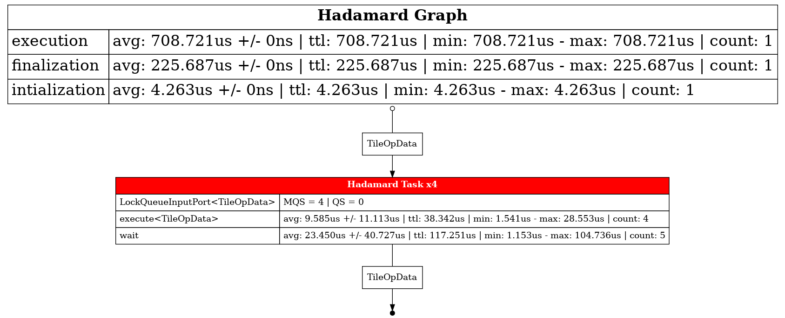

# Basic graph

In this example, we study a basic graph with a single task performing an
Hadamard product on matrix tiles. In order to use this graph, we need to split
the matrix and push the tiles to the graph. Before stopping the graph, we need
to wait for all the times to be multiplied (we use `eat_results` here).

## Compile

```sh
c++ -std=c++20 -I../../../../ main.cpp -o prog -DHH_ENABLE_PROFILING
```

## Graph


