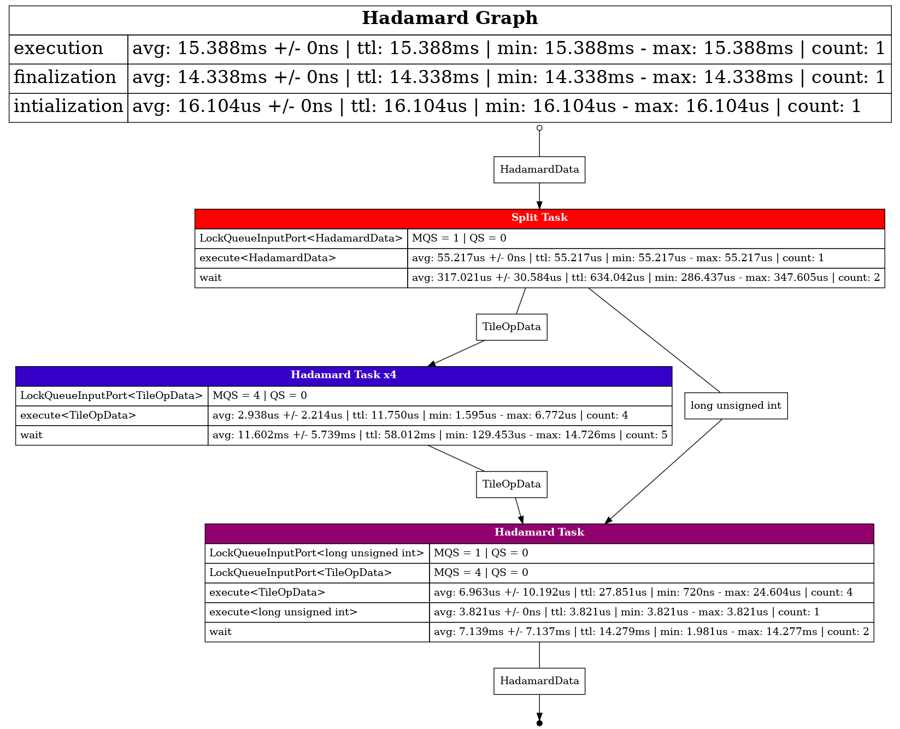

# Use states

This example is the same as the previous one (Hadamard product), but includes a
splitting task at the beginning of the graph and an accumulator state at the end.
This way, the graph tasks the matrix triplet as input and returns it when the
computation is done. The split task is used to create the tiles and the
accumulator state is used to count the result tile to know when the product is
complete.

Note that here we use a single threaded task and not a state because we only
need this data at a single point of our graph (we don't need to share a state
across nodes). Note as well that such a graph can only perform one product at a
time because the state (tile counter) is bound to the node. Another option
would be to attach the state to the data (to the tile), which would allow
multiplying multiple tiles from different products in parallel.

## Compile

```sh
c++ -std=c++20 -I../../../../ main.cpp -o prog -DHH_ENABLE_PROFILING
```

## Graph


